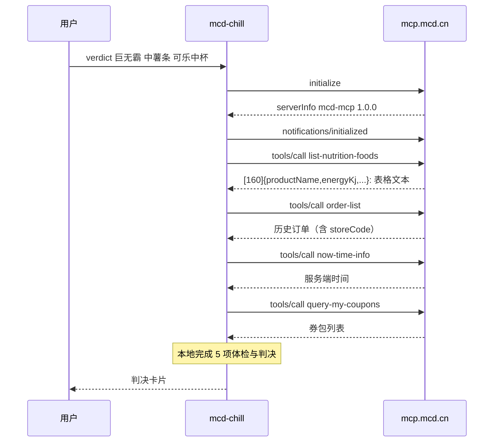
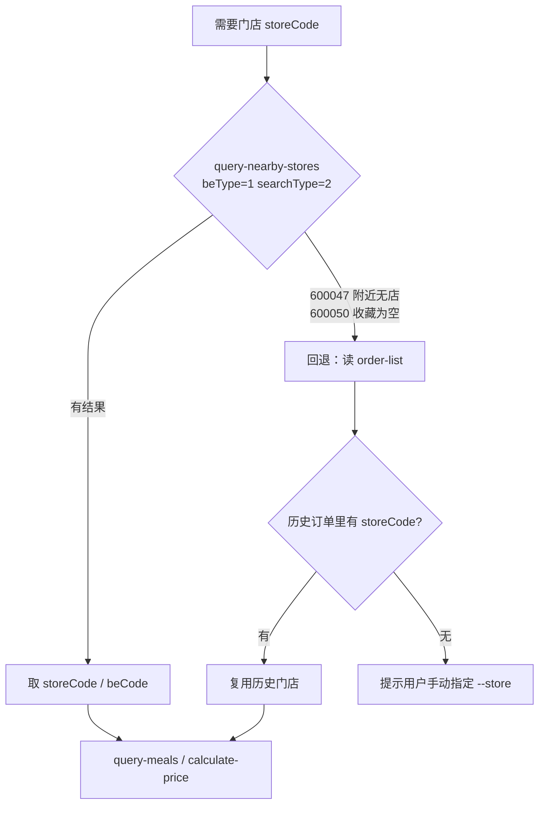

# 麦当劳 MCP 集成说明

本文说明麦麦冷静期（`mcd-chill`）实际使用的麦当劳 MCP Server、Tool、调用流程，
以及联调过程中发现的真实接口约束。

---

## 一、接入方式

| 项 | 值 |
|---|---|
| Server 名称 | `mcd-mcp`（`serverInfo.name`，版本 `1.0.0`） |
| 接入地址 | `https://mcp.mcd.cn` |
| 传输协议 | Streamable HTTP（JSON-RPC 2.0 over HTTP POST） |
| 鉴权 | 请求头 `Authorization: Bearer <MCD_MCP_TOKEN>` |
| 协议版本 | `2025-03-26` |
| 限流 | 600 次/分钟，超限返回 `429` |
| SDK 依赖 | 无。本项目的客户端 `src/mcd_mcp.py` 只用 Python 标准库实现 |

本项目**不使用任何 LLM 客户端或第三方 MCP SDK**：`src/mcd_mcp.py` 直接完成
`initialize` → `notifications/initialized` → `tools/call` 的完整握手，
因此整个 Skill 可以脱离 AI 客户端独立运行，判决结果是确定性的、可复现的。

### 客户端实现要点

1. **服务端是无状态实现**：`initialize` 响应里不返回 `Mcp-Session-Id`，
   每个请求都是独立的 POST，无需维护会话。
2. **必须同时接受两种响应体**：`Content-Type` 可能是 `application/json`，
   也可能是 `text/event-stream`（SSE）。客户端需要按 `data:` 行解析 SSE 并取最后一条消息。
3. **必须传 `Accept: application/json, text/event-stream`**，否则服务端可能拒绝。

---

## 二、使用的 Tool 清单

本项目共调用 **8 个只读 Tool**，不涉及任何下单、取消、扣积分等写操作。

| # | Tool | 用途 | 关键入参 | 调用时机 |
|---|---|---|---|---|
| 1 | `list-nutrition-foods` | 160 条餐品营养库（热量/蛋白/脂肪/碳水/钠/钙） | 无 | 每次体检前拉一次，作为本地营养基准 |
| 2 | `order-list` | 近 90 天历史订单（到店 + 外送） | 无 | 计算消费账本、复购次数，并**反推默认门店** |
| 3 | `now-time-info` | 服务端当前时间 | 无 | 判断深夜进食、下午茶等情境风险 |
| 4 | `query-my-coupons` | 用户卡包里的券 | `page` / `pageSize` | 判断这单有没有券可用 |
| 5 | `available-coupons` | 麦麦省可领券列表 | 无 | 提示"下单前先领券" |
| 6 | `query-nearby-stores` | 到店/得来速门店查询 | `beType` / `searchType` / `city` / `keyword` | 门店解析的第一顺位 |
| 7 | `query-meals` | 门店在售餐品 | `storeCode` / `orderType` / `beType` | 菜单级补充校验 |
| 8 | `available-coupons` → `calculate-price` | 含券真实到手价试算 | `storeCode` / `orderType` / `beType` / `items` | `--calculate-price` 时按需调用 |

> `list-nutrition-foods`、`order-list`、`now-time-info`、`query-my-coupons`
> 这 4 个是本项目每次运行都会依赖的核心 Tool。

---

## 三、调用流程

### 3.1 账号数据链路（冷启动）

### 3.2 门店解析链路（解决冷启动拿不到门店的问题）

这是本项目在联调中发现的**最关键的一处工程处理**：

> `query-nearby-stores` 的 `searchType=1` 语义是「搜索收藏餐厅」，
> 冷启动账号会直接返回 `600050 收藏餐厅列表为空，请您提供城市+关键词进行搜索`；
> 而 `searchType=2`（按位置搜索）依赖定位上下文，无定位时返回
> `600047 当前位置附近没有找到合适的餐厅`。
> 因此本项目把 `order-list` 里带出的 `storeCode` 作为默认门店兜底 ——
> 用户只要在麦当劳小程序下过一单，整条点餐链路就能自动打通。

---

## 四、联调中发现的真实约束

以下均为使用真实 Token 实测得到的结论，官方文档未明确写出。

| # | 发现 | 影响的实现 |
|---|---|---|
| 1 | `initialize` 不返回 `Mcp-Session-Id`（无状态服务） | 客户端无需维护会话，但每个请求都要带全鉴权头 |
| 2 | 响应可能是 SSE，不一定是纯 JSON | 客户端需兼容两种 `Content-Type`，按 `data:` 行取最后一条消息 |
| 3 | `tools/call` 的结果里 `content[0].text` 是**「字段说明 + 原始响应」拼接的长文本**，不是纯数据 | 解析必须**优先取 `structuredContent`**，否则会把说明文字当数据 |
| 4 | `list-nutrition-foods` 的 `data` 既不是 JSON 数组，也是一段**紧凑表格文本** `[160]{productName,...}:` + 逐行 CSV | 自建解析器（`src/nutrition.py`），且**不能先 `json.dumps`**——换行会被转义成字面量 `\n`，按行切分立即失效 |
| 5 | 营养库只有 160 条，且**饮品占比极高**（咖啡/奶饮 59 条），餐品名称含大量联名创意名 | 替换建议必须先按品类分组，否则会出现「汉堡 → 炸鸡翅」这种无意义建议 |
| 6 | `query-meals` 只返回 `code` 和 `tags`，**不返回餐品名称与价格** | 需要展示名称时必须再用 `query-meal-detail` 按 code 补全 |
| 7 | `query-meals` / `query-meal-detail` / `calculate-price` / `query-store-coupons` 均强制要求 `storeCode` + `orderType` + `beType` | 门店解析必须是所有点餐类调用的前置步骤 |
| 8 | `query-nearby-stores` 的 `searchType=1` 是「收藏餐厅」而非「关键词搜索」 | 冷启动必须回退到历史订单取门店（见 3.2） |
| 9 | 业务错误以 `structuredContent.success=false` + `code` 返回（HTTP 仍为 200） | 客户端必须检查 `success`，不能只看 HTTP 状态码 |

---

## 五、业务价值

麦当劳 MCP 已经把「查菜单、算价、领券、下单」这些**动作**开放给了 Agent，
但用户的真实痛点不在动作层，而在**下单前那一瞬间的犹豫**：

- 这单吃完今天的热量还剩多少？
- 我是不是上周已经连吃了三天同一个堡？
- 我卡包里那张快过期的券，这单为什么没用上？

`mcd-chill` 用 MCP 的**只读能力**把这三件事一次性算清楚，
在不干预用户选择的前提下，把「凭感觉下单」变成「看着账下单」。

具体来说，本 Skill 对 MCP 能力的组合价值在于：

1. **`list-nutrition-foods` × `order-list` 的交叉** —— 单用营养库只能算「这单多少热量」，
   叠加历史订单才能算出「你最近日均吃了多少」，从而判断这单是不是显著超标。
2. **`order-list` 的双重用途** —— 既做消费账本，又作为门店 code 的兜底来源，
   让冷启动用户也能走通完整链路。
3. **`query-my-coupons` × `available-coupons` 的落差** ——
   把「有什么券」和「这单能不能用券」摆在一起，直接暴露可避免的浪费。

---

## 六、合规说明

- 本项目只调用**只读** Tool，不存在自动下单、自动扣积分、取消他人订单等行为。
- `mcp-config.example.json` 仅使用 `${MCD_MCP_TOKEN}` 环境变量占位符，不含任何真实 Token。
- 仓库内不包含任何真实 Token、账号凭证或他人个人信息；
  `.gitignore` 已排除联调产物目录 `probe_out/`（该目录会落盘真实账号响应）。
- 本项目为参赛作品，由参赛者独立开发，非麦当劳官方产品。
