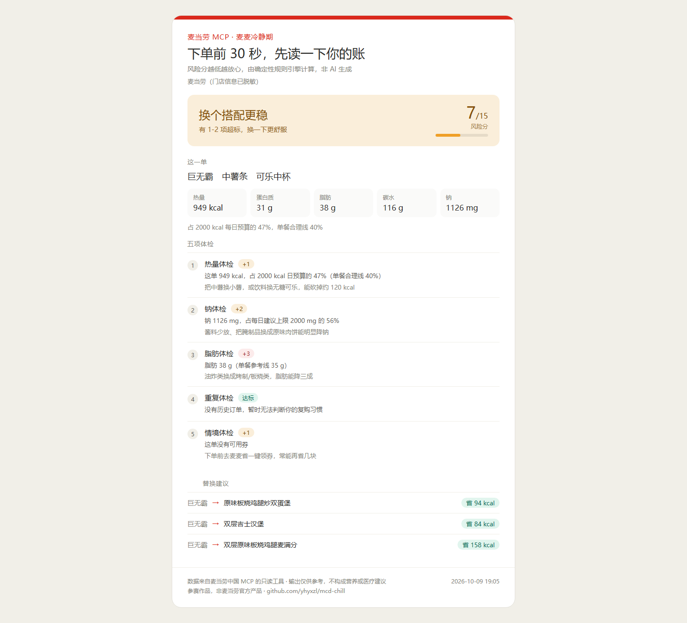

# 麦麦冷静期 · mcd-chill

> 别的工具帮你更快下单，这个工具帮你**别下错单**。
>
> 基于麦当劳中国 MCP 的纯 Python 点餐前体检器 —— 在你点"提交订单"之前，
> 用你自己的真实数据算清三笔账：**这单吃了多少、你是不是又在重复、那张券为什么没用上。**

---



---

## 它解决什么问题

麦当劳 MCP 已经能把「查菜单、算价、领券、下单」交给 Agent 了。
但真正的痛点不在动作层，在下单前那一瞬间的犹豫：

| 你的疑问 | 大部分工具的答案 | mcd-chill 的答案 |
|---|---|---|
| 这单多少热量？ | 念一遍营养表 | 949 kcal，占你日预算的 **47%**，超单餐合理线 7 个点 |
| 吃完还行吗？ | 不回答 | 脂肪 38 g 超标 **+3**、钠 1126 mg 占每日上限 **56%** |
| 我是不是老吃这个？ | 不回答 | 近 7 天同一单品点了 N 次（需账号有历史订单） |
| 有更划算的吃法吗？ | 不回答 | 巨无霸 → 双层吉士汉堡，**省 84 kcal 蛋白不降** |

> 上表右列是各项体检**能给出**的结论类型，具体数值取决于你的实际订单。

---

## 实际运行效果

```
==========================================================
  麦麦冷静期   下单前 30 秒，先读一下你的账
  门店：麦当劳（门店信息已脱敏）
==========================================================

  购物车  巨无霸  中薯条  可乐中杯
  合  计  949 kcal · 蛋白 31 g · 脂肪 38 g · 碳水 116 g · 钠 1126 mg

  判  决  [WARN]  换个搭配更稳    风险分 7 / 15
          有 1-2 项超标，换一下更舒服

  1. 热量体检      +1   这单 949 kcal，占 2000 kcal 日预算的 47%（单餐合理线 40%）
     -> 把中薯换小薯，或饮料换无糖可乐，能砍掉约 120 kcal
  2. 钠体检       +2   钠 1126 mg，占每日建议上限 2000 mg 的 56%
     -> 酱料少放、把腌制品换成原味肉饼能明显降钠
  3. 脂肪体检      +3   脂肪 38 g（单餐参考线 35 g）
     -> 油炸类换成烤制/板烧类，脂肪能降三成
  4. 重复体检           没有历史订单，暂时无法判断你的复购习惯
  5. 情境体检      +1   这单没有可用券
     -> 下单前去麦麦省一键领券，常能再省几块

  替换建议
    巨无霸 -> 原味板烧鸡腿炒双蛋堡   省 94 kcal（蛋白 27 g）
    巨无霸 -> 双层吉士汉堡   省 84 kcal（蛋白 27 g）
    巨无霸 -> 双层原味板烧鸡腿麦满分   省 158 kcal（蛋白 23 g）

----------------------------------------------------------
  数据来自麦当劳 MCP · 输出仅供参考，不构成营养或医疗建议
```

---

## 五个体检项怎么算

判决不是拍脑袋，是一套**确定性的规则引擎**（`src/verdict.py`），跑一次只要几百毫秒，结果可复现。

| 体检项 | 数据来源 | 扣分规则 |
|---|---|---|
| 热量体检 | `list-nutrition-foods` | 占日预算 ≤40% 不扣；≤55% +1；≤70% +2；更高 +3 |
| 钠体检 | `list-nutrition-foods` | ≤600mg 不扣；≤900 +1；≤1300 +2；更高 +3 |
| 脂肪体检 | `list-nutrition-foods` | ≤25g 不扣；≤35g +1；更高 +3 |
| 重复体检 | `order-list` | 近 7 天同一单品 1 次不扣；2 次 +1；3 次 +2；≥4 次 +3 |
| 情境体检 | `now-time-info` + `query-my-coupons` | 深夜进食 +2；无可用券 +1，上限 +3 |

**判决线**：0–3 分「可以吃」 / 4–7 分「换个搭配更稳」 / 8–15 分「再想想」。

> 重复体检依赖 `order-list` 的历史订单。账号没有历史订单时该项不扣分，
> 并在输出中如实标注「没有历史订单，暂时无法判断你的复购习惯」——
> 上面那段演示输出就是这种情况。

替换建议只在**同品类内**给（汉堡换汉堡、配餐换配餐），
避免出现「巨无霸 → 炸鸡翅」这类没有参考价值的建议。

---

## 快速开始

### 1. 申请麦当劳 MCP Token

访问 <https://open.mcd.cn/mcp> → 手机号登录 → 右上角「控制台」→「激活」→ 复制 Token。

### 2. 配置环境变量

```bash
# macOS / Linux
export MCD_MCP_TOKEN="你的 Token"

# Windows PowerShell
$env:MCD_MCP_TOKEN = "你的 Token"
```

也可以直接写进 MCP 客户端的配置里（见 `mcp-config.example.json`）：

```json
{
  "mcpServers": {
    "mcd-mcp": {
      "type": "streamablehttp",
      "url": "https://mcp.mcd.cn",
      "headers": { "Authorization": "Bearer ${MCD_MCP_TOKEN}" }
    }
  }
}
```

### 3. 跑起来

**零依赖**，不需要 `pip install` 任何东西（只用 Python 标准库，Python 3.10+）。

```bash
git clone https://github.com/yhyxzl/mcd-chill.git
cd mcd-chill

# 下单前体检（默认命令，直接把餐品名接在后面）
python src/cli.py 巨无霸 中薯条 可乐中杯

# 自定义每日热量预算
python src/cli.py 巨无霸 中薯条 --budget 1800

# 只看账本
python src/cli.py ledger

# 查营养库
python src/cli.py lookup 巨无霸 --fuzzy

# 查门店在售餐品
python src/cli.py menu --store <你的门店编号>

# 生成一张可截图分享的卡片（自动脱敏门店信息）
python src/cli.py 巨无霸 中薯条 --share --html out/card.html --open
```

---

## 命令说明

| 命令 | 作用 |
|---|---|
| `verdict <餐品...>` | 对一单做 5 项体检并给出判决（默认命令，可省略 `verdict`） |
| `ledger` | 消费账本：近 7/30 天单数、金额、单均、最常点、复购提醒 |
| `menu --store <code>` | 查询指定门店在售餐品（`query-meals`） |
| `lookup <关键词>` | 查营养库，`--fuzzy` 时同时列出模糊匹配 |

`verdict` 的参数：

| 参数 | 作用 |
|---|---|
| `--budget <kcal>` | 每日热量预算，默认 2000 |
| `--qty <n>` | 对应餐品的数量，可重复 |
| `--json` | 输出机器可读结果 |
| `--share` | **隐藏门店名与编号**，截图分享前加上 |
| `--html <路径>` | 额外生成一张可分享的 HTML 卡片 |
| `--open` | 生成卡片后用浏览器打开 |
| `--calculate-price` | 额外调用 MCP 算真实到手价 |

---

## 生成分享卡片

上图就是 `--html` 的输出。截图发出去之前记得加 `--share` ——
门店名会暴露你常去的位置，脱敏后只会显示「麦当劳（门店信息已脱敏）」。

```bash
python src/cli.py 巨无霸 中薯条 可乐中杯 --share --html out/card.html --open
```

卡片是**单文件 HTML**，不含任何外部资源（无 CDN、无外链字体），
生日色块用的是麦当劳品牌红 `#DA291C`。

---

## 项目结构

```
mcd-chill/
├── src/
│   ├── mcd_mcp.py      # 零依赖 MCP 客户端：Streamable HTTP + JSON-RPC + SSE 兼容
│   ├── nutrition.py    # 解析 list-nutrition-foods 的紧凑表格格式 + 品类分组
│   ├── ledger.py       # 历史订单 → 消费账本 / 复购统计 / 默认门店反推
│   ├── verdict.py      # 5 项体检 + 判决规则引擎
│   ├── report.py       # 判决结果 → 可截图分享的单文件 HTML 卡片
│   └── cli.py          # 命令行入口与终端渲染
├── scripts/
│   └── probe.py        # 联调探针：把只读 Tool 的真实响应落盘，便于校准解析
├── docs/
│   └── demo-card.png   # README 里那张卡片的源图
├── SKILL.md            # WorkBuddy Skill 定义
├── MCP_INTEGRATION.md  # MCP 集成说明与联调发现
└── mcp-config.example.json
```

---

## 设计取舍

**为什么不用 LLM 做判决？**
体检逻辑本身是确定的算术，交给 LLM 只会引入不确定性、延迟和成本。
本项目的判断链路完全由规则驱动 —— 同样的输入永远得到同样的判决，
便于用户复核，也便于自己写测试。LLM 适合用在"帮我把话说好听"，
不适合用在"这单该不该吃"。

**为什么用标准库手写 MCP 客户端，而不装 SDK？**
一是让 Skill 可以脱离任何 AI 客户端独立运行（`python src/cli.py` 即可）；
二是这个过程中把 McD MCP 的几个真实坑都摸清了（见 `MCP_INTEGRATION.md` 第四节），
这些约束对后续基于麦当劳 MCP 开发的人都有效。

**为什么只做只读？**
自动下单这类写操作风险太高，一次误判就是真金白银。
本项目只读数据、只给建议，最终按不按下单键永远在用户手里。

**为什么会专门做一个 `--share`？**
因为门店名会暴露你常去的位置，而这个工具天然就是用来截图分享的。
隐私保护不该指望用户记得手动涂改，所以内建了脱敏开关。
同理，联调产物目录 `probe_out/`（会落盘真实账号响应，含 accountId）
已在 `.gitignore` 排除，不会被误提交。

---

## 免责声明

- 本项目为**麦当劳程序员节创意开发大赛参赛作品**，由参赛者独立开发，**非麦当劳官方产品**。
- 项目输出仅供参考，不构成医疗、营养或其他专业建议；
  餐品信息、价格及供应状态以麦当劳官方渠道的实时结果为准。
- 本项目仅调用麦当劳 MCP 的只读工具，不会自动下单或操作你的账户资产。

## License

MIT
